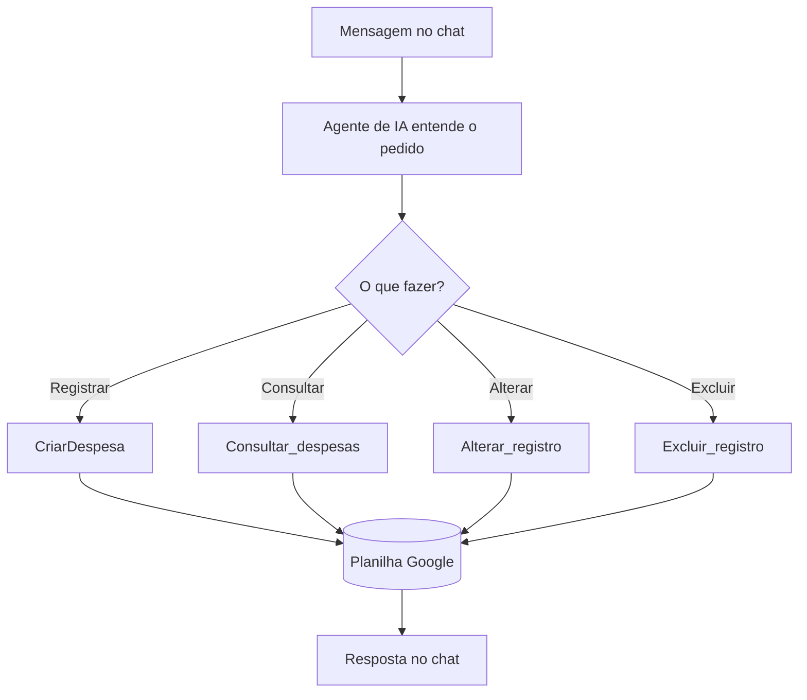

# Projeto FinBot: agente de finanças pessoais

Você conversa em linguagem natural ("gastei 45 reais de pizza hoje") e o agente **registra, consulta, altera ou exclui** lançamentos numa planilha do Google.

## Peças

| Peça | No FinBot |
|---|---|
| Gatilho | *When chat message received* (chat do n8n) |
| Cérebro | AI Agent com prompt de sistema (categorias, tipos, confirmação antes de excluir) |
| Modelo | OpenRouter → `google/gemini-3.5-flash` |
| Memória | Postgres Chat Memory (Neon) |
| Ferramentas | registrar gasto, consultar registros, alterar_registro, excluir_registro, Calculator |
| Bônus | Relatório mensal: todo dia 1 o agente resume o mês e envia por e-mail |

## Montando

1. **Planilha**: crie uma planilha no Google Sheets e importe `planilhas/FinBot_modelo.csv` (*Arquivo → Importar*). Colunas: `ID, DATA, DESCRIÇÃO, CATEGORIA, TIPO, VALOR`.
2. **Importe primeiro os sub-workflows** (`2_CriarDespesa`, `3_Consultar_despesas`, `4_Alterar_registro`, `5_Excluir_registro`). Em cada um: escolha a credencial do Google Sheets, cole o ID da planilha e **publique**.
3. **Importe `1_FinBot_agente_principal.json`**. Nos nós de ferramenta (*registrar gasto*, *consultar registros*, *alterar_registro*, *excluir_registro*) o campo *Workflow* diz `ESCOLHA AQUI: ...`: selecione o sub-workflow correspondente.
4. Escolha as credenciais do **OpenRouter** (modelo) e do **Postgres** (memória).
5. Abra o chat (botão **Open chat**) e teste:
   - "Gastei 45 reais de pizza hoje"
   - "Quanto eu gastei com alimentação este mês? soma pra mim"
   - "A pizza na verdade foi 50 reais, corrige pra mim"
6. Veja a aba **Executions**: dá para acompanhar memória → modelo → ferramenta e os tokens gastos.

### Bônus: relatório mensal (`6_Bonus_Relatorio_mensal.json`)
No nó **Config** coloque o seu e-mail e, no nó *consultar registros*, escolha o `Consultar_despesas`. O nó **Copy file** vem desativado (é opcional: copia um arquivo do Drive depois do envio).

## Por que OpenRouter e não o nó Gemini direto?
O nó *Google Gemini Chat Model* funciona bem em chamadas simples (exemplo 05), mas dentro de um agente que usa 2 ou mais ferramentas seguidas ele às vezes responde com o texto `Calling ...` em vez de chamar a ferramenta. Pelo OpenRouter, o mesmo Gemini funciona.
No workflow principal, os nós *OpenAI*, *Gemini* e *Create spreadsheet* ficam de "peças reserva", desconectados.
