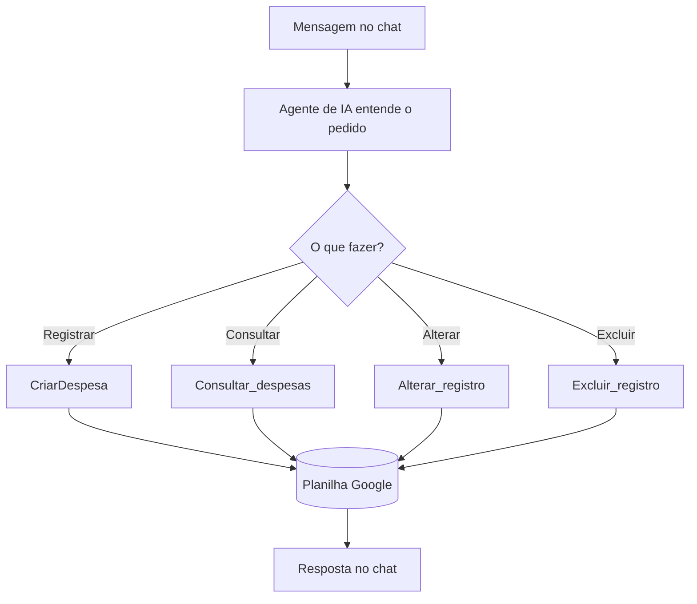

# Projeto FinBot: agente de finanças pessoais

Você conversa em linguagem natural ("gastei 45 reais de pizza hoje") e o agente **registra, consulta, altera ou exclui** lançamentos numa planilha do Google.

## Duas versões do agente principal

| Arquivo | Para quem | Modelo | Memória | Chaves necessárias |
|---|---|---|---|---|
| `1b_FinBot_agente_n8n_cloud.json` ⭐ | **n8n Cloud** (recomendado na aula) | Google Gemini Chat Model (`gemini-3.5-flash`) | **Simple Memory** (já vem no n8n) | **Só a do AI Studio** |
| `1_FinBot_agente_principal.json` | n8n self-hosted / versão do professor | OpenRouter → `google/gemini-3.5-flash` | Postgres Chat Memory (Neon) | OpenRouter + Postgres |

Os sub-workflows (`2` a `5`) e o bônus (`6`) são os mesmos nas duas versões.

## Peças

| Peça | No FinBot |
|---|---|
| Gatilho | *When chat message received* (chat do n8n) |
| Cérebro | AI Agent com prompt de sistema (categorias, tipos, confirmação antes de excluir) |
| Modelo | Gemini (direto ou via OpenRouter) |
| Memória | Simple Memory (Cloud) ou Postgres Chat Memory (self-hosted) |
| Ferramentas | registrar gasto, consultar registros, alterar_registro, excluir_registro, Calculator |
| Bônus | Relatório mensal: todo dia 1 o agente resume o mês e envia por e-mail |

## Montando (n8n Cloud)

1. **Planilha**: crie uma planilha no Google Sheets e importe `planilhas/FinBot_modelo.csv` (*Arquivo → Importar*). Colunas: `ID, DATA, DESCRIÇÃO, CATEGORIA, TIPO, VALOR`.
2. **Importe primeiro os sub-workflows** (`2_CriarDespesa`, `3_Consultar_despesas`, `4_Alterar_registro`, `5_Excluir_registro`). Em cada um: escolha a credencial do Google Sheets (*Sign in with Google*), cole o ID da planilha e **publique**.
3. **Importe `1b_FinBot_agente_n8n_cloud.json`**. Nos nós de ferramenta (*registrar gasto*, *consultar registros*, *alterar_registro*, *excluir_registro*) o campo *Workflow* diz `ESCOLHA AQUI: ...`: selecione o sub-workflow correspondente.
4. No nó **Google Gemini Chat Model**, escolha a credencial com a chave do AI Studio. A **Simple Memory** não precisa de nada.
5. Abra o chat (botão **Open chat**) e teste:
   - "Gastei 45 reais de pizza hoje"
   - "Quanto eu gastei com alimentação este mês? soma pra mim"
   - "A pizza na verdade foi 50 reais, corrige pra mim"
6. Veja a aba **Executions**: dá para acompanhar memória → modelo → ferramenta e os tokens gastos.

**Self-hosted:** mesmos passos, mas importe `1_FinBot_agente_principal.json` e escolha as credenciais do **OpenRouter** (modelo) e do **Postgres** (memória).

### Simple Memory × Postgres
- **Simple Memory**: guarda as últimas mensagens (10, neste workflow) de cada conversa dentro do n8n. Zero configuração, perfeito para aprender.
- **Postgres**: guarda o histórico num banco de dados; continua lá mesmo se o n8n reiniciar. Use num projeto de verdade.

### Bônus: relatório mensal (`6_Bonus_Relatorio_mensal.json`)
No nó **Config** coloque o seu e-mail e, no nó *consultar registros*, escolha o `Consultar_despesas`. O modelo ligado é o OpenRouter: no Cloud, troque pelo **Google Gemini Chat Model**. O nó **Copy file** vem desativado (é opcional: copia um arquivo do Drive depois do envio).

## Se o agente responder "Calling ..."
Nos testes, o nó *Google Gemini Chat Model* dentro de um agente às vezes responde com o texto `Calling ...` em vez de chamar a ferramenta, principalmente quando precisa de 2 ou mais ferramentas seguidas (ex.: consultar e depois somar).
O que fazer:
1. Mande a mensagem de novo, pedindo uma coisa por vez.
2. Se continuar, troque a peça do modelo: ligue o **OpenRouter Chat Model** (que está nas "peças reserva") no lugar do Gemini. É o mesmo Gemini, mas por outro caminho, e funciona com várias ferramentas. Precisa de chave do OpenRouter com crédito.
